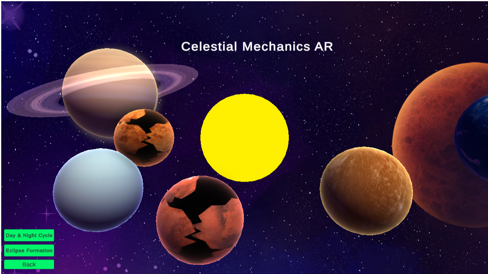
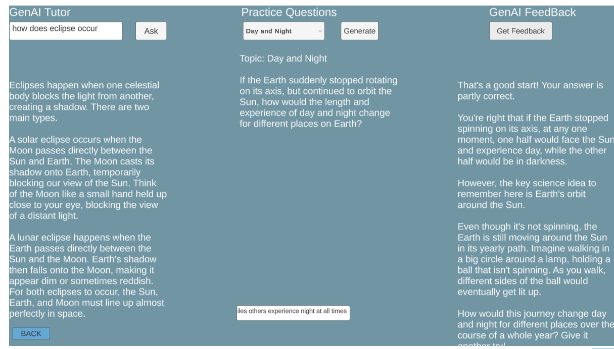
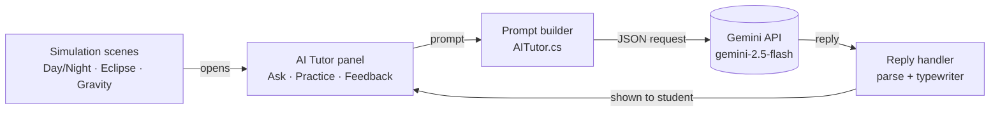

<div align="center">

# 🌍 Educational Simulation App with AI Tutor

### See it. Explore it. Ask about it. Understand it.

An interactive 3D science learning app built in **Unity**, where students experiment with **Day and Night**, **Eclipses** and **Gravity**, then get instant help from a **Gemini-powered AI Tutor**.


</div>

---

## ✨ Why this app?

Some science ideas are hard to picture from a textbook. Day and night, eclipses and orbits all depend on **3D motion**, and gravity is simply **too abstract** to grasp from static diagrams or whiteboard sketches.

This app makes those ideas **visible and interactive**, and adds an AI tutor so students can ask questions, practise and get feedback in simple language, any time.

---

## 🎮 Features

| | Feature | What it does |
|---|---|---|
| 🌗 | **Day / Night simulation** | Watch Earth's rotation create day, night, sunrise and sunset in real time. |
| 🌑 | **Eclipse simulation** | Explore how the Sun, Moon and Earth line up to form solar and lunar eclipses. |
| 🍎 | **Gravity simulation** | Experiment with gravity and falling motion to see how it behaves. |
| 💬 | **Ask AI Tutor** | Type any question and get a short, simple answer. Off-topic questions are politely redirected. |
| 📝 | **Get Practice Questions** | Pick a topic (Any, Day and Night, Eclipse, Gravity) and receive a fresh AI-generated conceptual question. |
| ✅ | **Get AI Feedback** | Answer the question and learn whether you are correct, partly correct or not yet correct, with a hint instead of a giveaway. |
| 📱 | **Cross-platform** | Runs on WebGL, Android and Desktop. |

### 📸 Screenshots

| Main menu | Celestial Mechanics (Day/Night and Eclipse) |
|:---:|:---:|
|  |  |
| | 


| Gravity simulation | GenAI Tutor panel |
|:---:|:---:|
|  |  |

The **GenAI Tutor Panel** button in each simulation opens the tutor. In the screenshot above, a student asks "how does eclipse occur", generates a Day and Night practice question, and receives feedback on their answer: partly correct, the key idea to remember, and a hint to try again.

---

## 🌐 Live Demo

You can access the app directly by clicking on the link:
https://ezrayalley.github.io/Educational-Simulation-App/

---
## 🧠 Learning Journey

```text
Select Simulation → Interact in 3D → Observe the Phenomenon → Ask AI Tutor
        → Get Practice Questions → Receive AI Feedback → Develop Understanding
```

### The pedagogy behind each feature

<<<<<<< HEAD
- **Simulations:** learning by doing lets students *see* rotation, alignment and gravity rather than imagine them, lowering mental load.
- **Ask AI Tutor:** instant, on-demand help scaffolds self-paced learning.
- **Practice Questions:** self-testing (retrieval practice) strengthens memory, and topic choice gives learners control.
- **AI Feedback:** timely formative feedback with hints keeps students thinking and trying again.
- **Cross-platform:** flexible access supports different learning environments.
=======
---


## 👥 Contribution
Contributions are welcome from anyone passionate about education, space, science, physics, and simulation!

### How to Contribute:
1. Fork the repository and create your own branch.
2. Make your changes, be it improvements, bug fixes, or new features.
3. Submit a pull request with a description of what you've done.
>>>>>>> 8fdb9e5c4f09a507692729f29d8c7828c6685a2c

---

## 🛠️ How it works



Each tutor button builds a prompt that fixes the tutor's role, the three-topic scope and a **high school reading level**. The prompt is sent to Gemini as JSON over HTTPS, then the reply is parsed and typed onto the screen.

**Tech stack:** Unity 3D · C# · TextMeshPro · UnityWebRequest · Google Gemini API (`gemini-2.5-flash`)

---

## 🚀 Getting Started

### Prerequisites
- [Unity Hub](https://unity.com/download) and the Unity version used by this project (check `ProjectSettings/ProjectVersion.txt`)
- A free Gemini API key from [Google AI Studio](https://aistudio.google.com/apikey)

### Run the project
```bash
git clone https://github.com/<your-username>/<your-repo>.git
```
1. Open the folder in **Unity Hub**.
2. Open the AI Tutor scene and select the object with the `AITutor` script.
3. Paste your key into the **Api Key** field in the Inspector.
4. Make sure each tutor button's **On Click** calls `AskQuestion()`, `GenerateQuestion()` or `SubmitAnswer()`.
5. Press **Play**.

### Build
**File → Build Settings →** add all scenes → choose **WebGL**, **Android** or **Windows** → **Build**.

---

## 🔮 Future Improvements

- 📚 **RAG** so AI answers are grounded in the syllabus
- 🧩 Additional interactive learning activities
- 🥽 Extend to **AR / VR**

---

---

## 📄 License
MIT lincense

<div align="center">

⭐ If you find this project useful, please give it a star! ⭐
- Email: ezra.yalley@gmail.com

</div>
